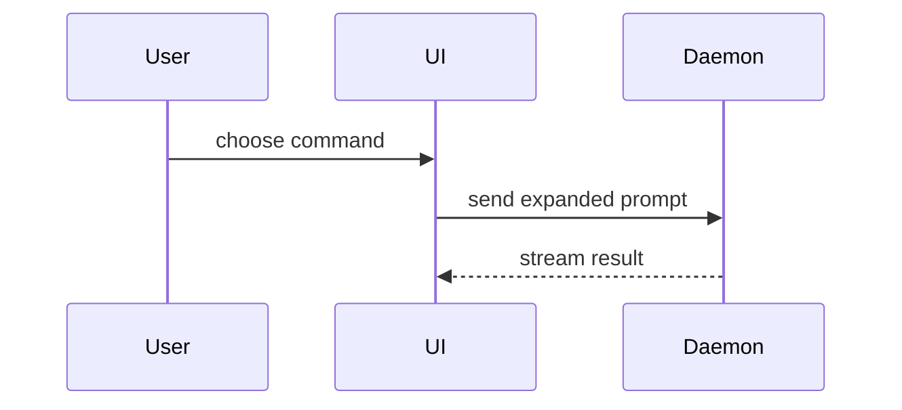

Done when the body follows this template, every result in it comes from evidence already gathered, and every gap is on the **Not done** line. Writing or updating a body runs nothing.

Use this template for writing the PR body, and when updating one:

```markdown
## Why

<one to three sentences on the problem or need, linking the issue>

## Summary

<diagram, diff-sketch, or tree>

## Evidence

- **Before:** <screenshot/output/failing test run>
  **After:** <screenshot/output/passing test run>

## Merge Danger

**Door:** <one-way or two-way>

<optional: description>

**Blast Radius:** <one-word description>

<optional: potential ramifications of merge>

**Not done:** <optional: what was left out or left unfixed>

🤖 <model> in <harness>
```

## Sections

Skip all preambles and keep prose brief. Use the user's domain language from `GLOSSARY.md`. When `writing-for-agents` is installed, follow it for the prose.

### Why

One to three sentences on the problem or need, in glossary language, linking the issue. No technical detail.

### Summary

Pick the smallest view that makes the key point clear.

- Show logic or an algorithm as pseudocode:

```text
on(save)
  if content is unchanged
    return cached result
  write new content
  return fresh result
```

- Show runtime control flow as a call tree:

```text
submitForm
  createSession
    persistPrompt
    launchAgent
  navigateToSession
```

- Show UI structure as a component tree, including state and module boundaries that matter:

```text
<SessionPage> (apps/example/src/routes/session.tsx)
  useSessionEvents()
  <SessionToolbar>
    <RunSkillButton> (packages/ui)
```

- Show file responsibility or a broad refactor as a shallow file tree:

```text
src/
├── commands/       # parses user actions
├── sessions/       # owns session state
└── transport/      # sends API requests
```

- Show component interaction, control flow, or data flow with Mermaid:



- Use `diff` when the point is what changes and the surrounding shape already exists. Match the diff shape to the topic.

For a component change:

```diff
 <SessionPage>
   useSessionEvents()
   <SessionToolbar>
+    <RunSkillButton />
   <SessionTimeline>
+    <SkillResultCard />
```

For a file-layout change:

```diff
 src/
 ├── commands/
+│   └── show-me.ts       # expands the slash command
 ├── sessions/
-└── transport.ts
+└── transport/
+    ├── client.ts
+    └── stream.ts
```

For a call-tree or call-stack change:

```diff
 submitForm
   createSession
     persistPrompt
+    expandSkillMention
     launchAgent
-  navigateToSession
+  navigateToSession
+    subscribeToEvents
```

For a state or control-flow change:

```diff
 on(save)
-  write content
+  if content is unchanged
+    return cached result
+  write new content
+  invalidate cache
```

- Show the whole block when most of it is new, when omitted context would hide ownership or order, or when the user needs a copyable target shape:

```ts
function expandSkill(command: string): string {
  const skillName = command.slice(1);
  return `use the ${skillName} skill`;
}
```

#### Guidance

Place each visual next to the short text it supports. Keep only the calls, files, props, states, and boundaries needed to answer the user's current question or the options to resolve the current discussion point.

You may use one of these, you may use several, it is unlikely you will use all of them. Use your judgement and don't overwhelm the user.

### Evidence

Concrete evidence that the change works. Show a before and after.

Take it only from evidence already gathered: this session's own runs, CI results, or a delegate's report naming the tree it ran on. Read the change and that evidence, and run nothing: no tests, no benchmarks, no `verifying`.

Screenshots are S-tier - when one exists and the change is visual.

Execution-based evidence is A-tier. Test results, console output. Show the exact test that now fails and passes, using pseudocode.

Report the evidence and its gaps. Never claim a result nobody observed, and that includes a claim in a commit message or a doc with no run behind it. Name the tree a result ran on when it is not the branch's head. A gap goes on the **Not done** line.

Ask the project's listed pack guides for capturing visual evidence and reading test results; use the answer to find and read what already exists, and carry on silently when none answers.

### Merge Danger

Describe whether it's a one-way or two-way door. You can walk back through two-way doors, but not one-way doors. A PR that is cheap to roll back is lower risk. Changes that involve destructive actions or hard-to-reverse decisions are one-way doors.

The blast radius is the potential impact or scope of the changes introduced by this PR. Consider all possibilities. Examples are layout shift, breakages for consumers, mobile responsiveness, etc.

### Not done

One optional line: what was left out or left unfixed, evidence gaps included. Leave it out when there is nothing to say. `implement-spec`, `verifying` and `receiving-review` write into it when running unattended, so when you update the body, keep each entry until evidence already gathered settles it.

### Footer

The body ends with `🤖 <model> in <harness>`, its only attribution.

- `<model>`: the full public name the harness reports for the model writing the body, copied as reported (for example "Claude Opus 5.5", not "Claude"). Never guess it or shorten it to a family name. When the harness reports no model name, the footer is `🤖 <harness>`.
- `<harness>`: the harness you are running in (for example "Claude Code").
